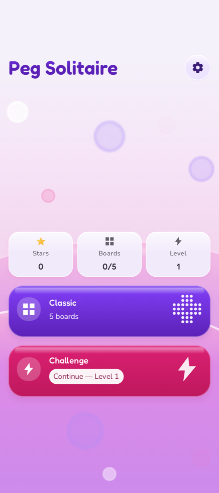
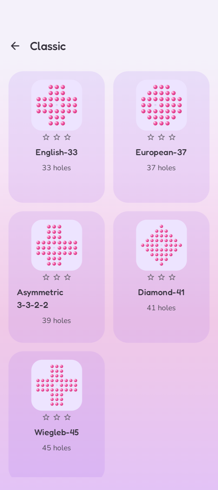
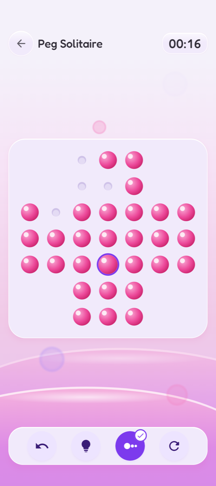
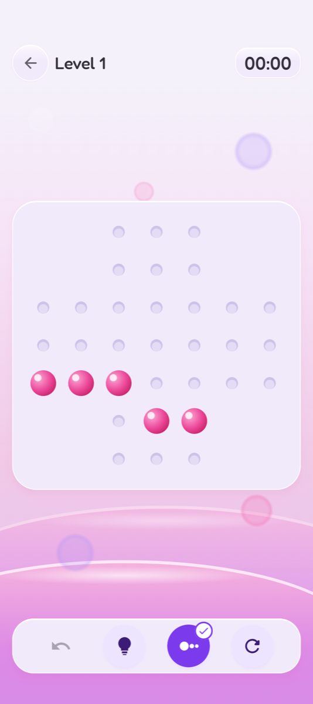
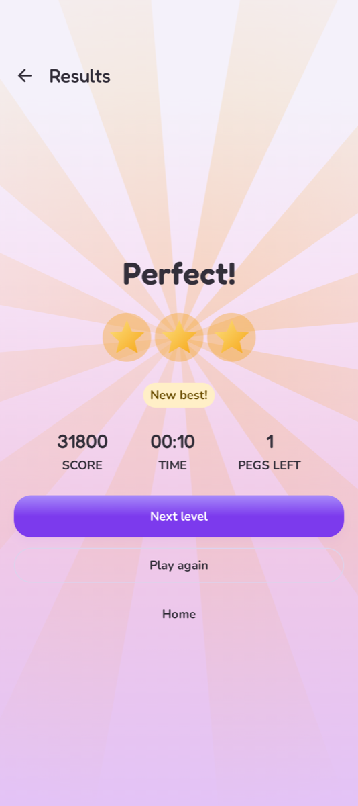
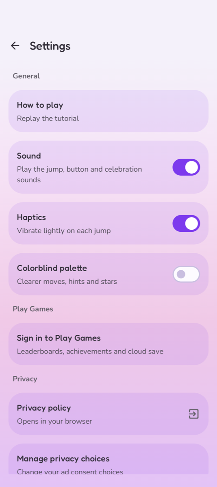

# Peg Solitaire

[](https://play.google.com/store/apps/details?id=com.erman.pegsolitarie)

Peg solitaire is a board game for one player involving movement of pegs on a board with holes. The standard game fills the entire board with pegs except for the central hole. The objective is, making valid moves, to empty the entire board except for a solitary peg in the central hole. A valid move is to jump a peg orthogonally over an adjacent peg into a hole two positions away and then to remove the jumped peg.   [more](https://en.wikipedia.org/wiki/Peg_solitaire)

<p float="center">
	
	
	
</p>
<p float="center">
	
	
	
</p>

## Features

- Five classic boards: English-33, European-37, Asymmetric 3-3-2-2, Diamond-41 and Wiegleb-45
- Challenge mode with endless generated levels that are always solvable and get harder as you climb
- Score, stars and best result for every board and level
- Undo, hints and showing the possible moves
- Interactive tutorial
- Resume an unfinished game from the Home screen
- Sound effects and haptics
- Google Play Games sign-in with leaderboards, achievements and cloud save
- Colorblind palette, TalkBack support and reduced motion
- English and Turkish

## Build & Run

- Requirements: JDK 17 and the Android SDK (compile SDK 36, minimum SDK 24).

- Clone git repository:

	```sh
	git clone https://github.com/ermanergoz/peg-solitarie.git
	```

- Import the project into Android Studio:
	- Open Android Studio. After that Click on “Open”. If a project is already open, click on File and then Click on Open.
	- Select the location of the cloned repository and then Click OK.
	- After Gradle operations are finished, the application will be ready to run.

- Or build from the command line:

	```sh
	./gradlew assembleDebug   # debug APK
	./gradlew check           # tests, detekt and ktlint
	```

- A debug build needs no extra configuration; it uses Google's test ad units. A release build needs the AdMob and Play Games IDs in `local.properties` (see `local.properties.template`) and the upload key credentials in the environment.

## Project Structure

- `domain` – pure Kotlin game logic: boards, rules, scoring, solver and Challenge level generator
- `app` – Android app: Jetpack Compose UI, persistence, sound, ads and Play Games
- `build-logic` – shared Gradle convention plugins

## Techniques & Dependencies

- [Kotlin](https://kotlinlang.org/) and [Coroutines](https://github.com/Kotlin/kotlinx.coroutines)
- [Jetpack Compose](https://developer.android.com/jetpack/compose) with [Material 3](https://m3.material.io/)
- [Navigation Compose](https://developer.android.com/jetpack/compose/navigation)
- [Hilt](https://dagger.dev/hilt/)
- [Room](https://developer.android.com/training/data-storage/room)
- [DataStore](https://developer.android.com/topic/libraries/architecture/datastore)
- [Kotlin Serialization](https://github.com/Kotlin/kotlinx.serialization)
- [Google Play Games Services](https://developer.android.com/games/pgs/overview)
- [Google Mobile Ads](https://developers.google.com/admob/android) and [User Messaging Platform](https://developers.google.com/admob/android/privacy)
- Testing: JUnit, Truth, Turbine, MockK, Robolectric, ArchUnit, Kover, detekt and ktlint

## Meta

Yusuf Erman ERGÖZ – erman.ergoz@gmail.com

Distributed under the MIT license. See ``LICENSE`` for more information.

[https://github.com/ermanergoz](https://github.com/ermanergoz)
